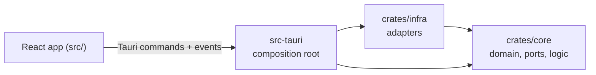
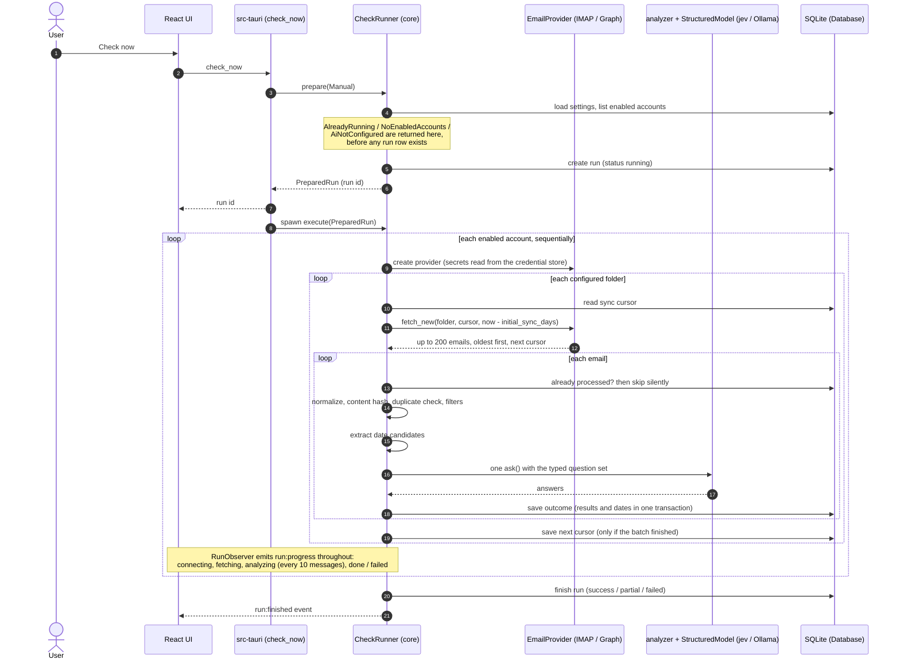

# Architecture

Academic Assistant is a Cargo workspace with three crates plus a React frontend. All
business logic is in a pure crate with no I/O; every side effect (SQLite, network, OS
credential store, sign-in windows) is an adapter behind a trait.

The app has two sources of information. The **LMS tracker** (Phase 2, the main Dashboard) reads
deliverables, exams and course events from Moodle and Blackboard, without AI. **Email analysis**
(Phase 1, the Announcements section) classifies university email with a structured AI provider.
They share the database, the secret store and the Tauri shell, and are otherwise independent: each
has its own runner, lock, events and tables.

## Crates and dependency rule



The dependency rule is `src-tauri -> infra -> core`. `core` never depends on `infra` or
`src-tauri`, and `infra` never depends on `src-tauri`.

| Crate | Responsibility | Reference |
|---|---|---|
| `crates/core` (`academic-core`) | Domain model, port traits, normalization, filters, date extraction, question building and answer assembly, the `CheckRunner` pipeline, and the LMS logic (URL normalization, session check, item diff, `LmsSyncRunner`). Only pure dependencies (`serde`, `serde_json`, `chrono`, `regex`, `sha2`, `html2text`, `async-trait`, `thiserror`, `indexmap`, `hex`). | [domain-and-ports](core/domain-and-ports.md), [normalization-and-filters](core/normalization-and-filters.md), [date-extraction](core/date-extraction.md), [email-analyzer](core/email-analyzer.md), [pipeline](core/pipeline.md), [lms](infra/lms.md) |
| `crates/infra` (`academic-infra`) | Implementations of the ports: SQLite repositories, Windows Credential Manager, IMAP, Microsoft Graph + OAuth, the Moodle and Blackboard clients, jev, Ollama, and the factories that pick a provider from stored configuration. | [database](infra/database.md), [secure-storage](infra/secure-storage.md), [imap](infra/imap.md), [microsoft-graph](infra/microsoft-graph.md), [lms](infra/lms.md), [ai-providers](infra/ai-providers.md), [factories](infra/factories.md) |
| `src-tauri` (`academic-assistant`) | Composition root: opens the database, builds the adapters, the `CheckRunner`, the `LmsSyncRunner` and the logging, registers the Tauri commands, translates domain types to DTOs, forwards run and sync progress as events and owns the LMS sign-in windows. | [tauri-commands](app/tauri-commands.md), [logging-and-data](app/logging-and-data.md) |
| `src/` (React) | Screens, an API client that wraps every command, event subscriptions and React Query caching. It never calls `invoke` outside `src/lib/api/`. | [frontend/overview](frontend/overview.md) |

The ports (traits) that connect the layers are: `EmailProvider` and `EmailProviderFactory`,
`LmsClient`, `LmsClientFactory` and `LmsAuthenticator`, `StructuredModel` and `ModelProvider`,
`SecretStore`, ten repository traits (`AccountRepository`, `CatalogRepository`,
`SyncStateRepository`, `ProcessedMessageRepository`, `ResultRepository`, `RunRepository`,
`SettingsRepository`, `UniversityRepository`, `CourseRepository`, `LmsItemRepository`), `Clock`,
`RunObserver` and `LmsSyncObserver`. See [core/domain-and-ports.md](core/domain-and-ports.md).

## Data flow of a "Sync" (LMS tracker)

```mermaid
sequenceDiagram
    autonumber
    actor U as User
    participant UI as React UI
    participant T as src-tauri (lms_sync)
    participant R as LmsSyncRunner (core)
    participant A as LmsAuthenticator (sign-in window)
    participant P as LmsClient (Moodle / Blackboard)
    participant D as SQLite (Database)

    U->>UI: Sync
    UI->>T: lms_sync(universityId or null)
    T->>R: prepare(universityId)
    Note over R: AlreadyRunning / NothingToSync<br/>are returned here
    R-->>T: PreparedSync (lock held)
    T-->>UI: ok
    T->>R: spawn execute(PreparedSync)
    loop each signed-in university, sequentially
        R->>P: verify (stored credential)
        alt rejected
            R->>A: renew_silently (hidden window)
            A-->>R: new credential, or sign-in required
        end
        R->>P: list_courses
        R->>D: upsert courses (new ones untracked)
        R->>P: fetch_items (tracked, available courses; events inside the window)
        P-->>R: items
        R->>D: diff against stored items, apply in one transaction
        R->>D: record the university's outcome
        Note over R,UI: lms-sync:progress at each stage
    end
    R-->>UI: lms-sync:finished (one result per university)
```

Key rules of the flow (details in [infra/lms.md](infra/lms.md)):

- `prepare` only checks the preconditions and takes the lock; at most one sync runs at a time,
  independently of any email check.
- Universities are synced one after another and fail independently. A university whose sync fails
  before the save step writes nothing; its outcome (`success`, `failed` or `login_required`) and
  error are recorded on the university.
- `fetch_items` is all or nothing. The diff marks new items (no badge during a course's first
  sync), due-date changes and removals, and never touches the user's done / hidden / note fields.
- A session that cannot be renewed silently ends the university as `login_required` and the
  Dashboard asks the user to sign in again.

## Data flow of a "Check now" run (email)



Key rules of the flow (details in [core/pipeline.md](core/pipeline.md)):

- The `check_now` command refuses to start while no course is tracked ("Track at least one course
  before checking email"), because the analyzer's course catalog is the tracked courses. This gate
  lives in the command layer, before `prepare`.
- `prepare` performs every precondition check and only then creates the run row; a failed
  `prepare` leaves no trace. A single-run lock guarantees at most one run at a time.
- Accounts and messages are processed sequentially. A failure in one account never prevents
  the others from running.
- Per message: an already-processed provider id is skipped silently; a duplicate (same
  `Message-ID` header or content hash for that account) or a filter match is recorded as
  `filtered`; the analyzer either finds it `irrelevant` or `analyzed` (creating a result).
- An `InvalidResponse` from the model marks that single message `failed` and processing
  continues. Auth, rate-limit or availability errors of the model stop the account and do
  **not** advance its cursor, so the same messages are retried on the next run.
- The cursor is advanced only when the whole batch was persisted. Startup recovery marks any
  run left `running` (for example after a crash) as `failed` with `Interrupted`.
- The run ends `success` (no account failed), `partial` (some failed) or `failed` (all
  failed), and `run:finished` is emitted exactly once.

## Data model overview

SQLite, one file (`academic-assistant.db`, in the app data directory), WAL mode, foreign keys on, schema in
`crates/infra/migrations/` (`0001_init.sql` for email, `0002_lms.sql` and `0003_lms_items.sql` for
the LMS tracker). Timestamps are RFC 3339 UTC text; result dates are
local `YYYY-MM-DD` / `HH:MM`. Details in [infra/database.md](infra/database.md).

| Table | Purpose |
|---|---|
| `universities` | The learning platforms the user follows: name, platform (`moodle` / `blackboard`), base URL, login state, account label and last sync. No credential is stored here |
| `courses` | Courses discovered on a platform: external id, name, short name, URL and the `tracked` / `available` / `reviewed` flags. Cascade from their university. The tracked, available ones are also the course catalog of the email analyzer |
| `lms_items` | Assignments, quizzes, tests and course events with status, grade, change badge, `removed_at` and the user's local done / hidden / note. Cascade from their university and course |
| `accounts` | Configured mailboxes: provider type (`provider_type`), provider JSON config (`config`, no secrets, no type tag), folders, default university, first-sync window, enabled flag. Ids are never reused (`AUTOINCREMENT`), so the secret keys derived from an account id can never be inherited by a later account |
| `sync_states` | Per account and folder: cursor, last run/success, status (`never`/`ok`/`error`), last error |
| `runs` | One row per check: status, timing, summed counters, error summary |
| `run_accounts` | Per run and account: status, counters, error kind and message |
| `processed_messages` | One row per email the pipeline looked at (outcome `filtered`/`irrelevant`/`analyzed`/`failed`, reason, content hash); used for deduplication. No subject or body |
| `ai_results` | One row per relevant email: subject, sender, category, priority, flags, university/course, model used, source URL, seen state |
| `result_dates` | Dates confirmed by the model for a result, each with a kind |
| `settings` | Key/value JSON settings (AI provider, models, URLs, Microsoft client ID, blocked senders) |
| `schema_migrations` | Applied migration versions (created by the app, not by the migration file) |

The database is the source of truth; the UI only renders what the commands return.

## Security and privacy model

- **Secrets** (IMAP passwords, Microsoft refresh tokens, the jev API key and the learning-platform
  credentials) live only in Windows Credential Manager, under keys such as
  `academic-assistant/account/{id}/password`, `academic-assistant/account/{id}/refresh-token`,
  `academic-assistant/jev-api-key`, `academic-assistant/university/{id}/moodle-token` and
  `academic-assistant/university/{id}/blackboard-session`. In Credential Manager the target of a
  key is `{key}.academic-assistant`. They are never written to SQLite, logs, DTOs, events, error
  messages or the repository. The frontend can only set or clear the jev key and learn whether it
  is configured; it can never read a secret back. Microsoft access tokens exist only in memory.
  See [infra/secure-storage.md](infra/secure-storage.md).
- **Learning-platform sign-in.** The university password is never captured or stored. The app
  opens the platform's own sign-in page in a separate window (own persistent browser profile,
  no access to the app's commands) and keeps only a scoped credential: a Moodle mobile
  web-service token, or the Blackboard session cookies of the platform host. Every credential is
  verified against the platform before it is stored. The URLs the window visits are never
  logged. Platform access is read-only and talks only to the platform URLs the user added; item
  titles, notes and grades stay in the local database and out of the logs. See
  [infra/lms.md](infra/lms.md).
- **Email bodies are not stored.** A body exists in memory while a message is processed.
  The database keeps structured results (subject, sender, classification, dates) and
  deduplication metadata (provider id, `Message-ID` header, content hash).
- **Providers are read-only.** IMAP uses `BODY.PEEK[]` (never sets `\Seen`) and never moves
  or deletes; Graph requests only the delegated permissions `Mail.Read`, `User.Read` and
  `offline_access`, so it can only read mail.
- **What is sent to jev** (only when jev is the selected provider): for each message that
  passed deduplication and the filters, the subject, sender name and address, received
  time, the normalized body (quotes and signatures removed, at most 12,000 characters), the
  default university name of the account, the question texts, and the catalog's course names
  and aliases offered as answer options. Nothing else. With Ollama, the same payload goes to
  the configured local URL (`http://localhost:11434` by default).
- **Logging** uses `tracing` with a daily rolling file (`logs/academic-assistant.log.<YYYY-MM-DD>`
  in the app data directory). Logs contain ids, counters, stages and sanitized errors, never
  bodies, subjects, tokens, passwords or keys. The start and end of each run are logged at
  `info` level without personal data. See [app/logging-and-data.md](app/logging-and-data.md).
- **Tauri surface:** the capability file (`src-tauri/capabilities/default.json`) grants only
  `core:event:default` (so the webview can listen to run and sync events) and
  `opener:allow-open-url` restricted to `https://` URLs (system browser, opener plugin), and only
  to the `main` window. The webview content
  security policy is `default-src 'self'` with IPC connections only.
- **OAuth:** authorization code with PKCE and a `state` check over a loopback listener on
  `127.0.0.1`; public client, no client secret. After sign-in the account email must match
  the signed-in mailbox's `mail` or `userPrincipalName`, otherwise the token is discarded.
  Changing a Microsoft account's email or tenant discards its stored sign-in, so it has to be
  signed in again. See [infra/microsoft-graph.md](infra/microsoft-graph.md).

## Extension points

### A new email provider

1. Add a variant to `ProviderConfig` / `ProviderKind` in `core::domain::account` (and, if it
   needs resumable sync, to `SyncCursor`).
2. Implement `EmailProvider` in a new module under `crates/infra/src/` (`test_connection` and
   `fetch_new`, at most `MAX_BATCH` emails oldest first, errors mapped to `ProviderError`).
3. Handle the new variant in `DefaultEmailProviderFactory::create`
   (`crates/infra/src/factory.rs`), reading any secret from `SecretStore`.
4. Add it to the accounts table `CHECK` constraint through a new migration, extend the DTOs and
   the account form. The pipeline itself does not change.

### A new AI provider

1. Implement `StructuredModel` (`descriptor`, `ask`) in a new module under `crates/infra/src/`,
   mapping its wire format to `Answer` values and its failures to `ModelError`.
2. Add a variant to `AiProviderKind`, handle it in `DefaultModelProvider::current`, and expose its
   settings (`Settings`, `SettingsDto`, Settings screen).
3. The analyzer, validation and pipeline are provider-agnostic and stay untouched.

### A new learning platform

1. Add a variant to `LmsPlatform` (`core::domain::lms`) and to the `platform` `CHECK` constraint
   through a new migration (never edit a released one); add its secret key suffix to
   `lms_credential_key`.
2. Implement `LmsClient` in a new module under `crates/infra/src/lms/` (`verify`, `list_courses`,
   `fetch_items`, read-only, errors mapped to `LmsError`; `Auth` means "sign in again"). Add a
   public probe to `probe.rs` and handle the variant in `DefaultLmsClientFactory`.
3. Teach the sign-in window (`src-tauri/src/lms_auth`) how to capture its credential.
4. Extend the platform dropdown and labels in the add wizard. The sync runner, diff, tracker and
   database are platform-agnostic and stay untouched.

### Other sources

Email goes through `EmailProvider` and learning platforms through `LmsClient`; each has its own
runner, tables and events. A third kind of source would add its own port and adapters in the same
way. The course catalog is a first-class input of the email analyzer (course options and
aliases): `CatalogRepository::catalog` now derives it from the tracked, available LMS courses.

See [development.md](development.md) for the concrete steps to add code to each layer.
