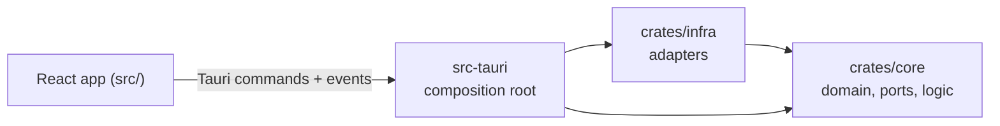
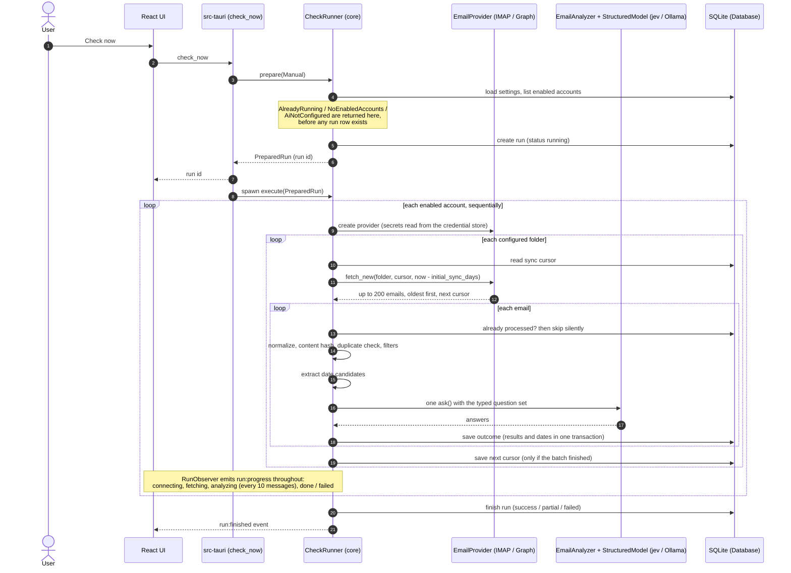

# Architecture

Academic Assistant is a Cargo workspace with three crates plus a React frontend. All
business logic is in a pure crate with no I/O; every side effect (SQLite, network, OS
credential store) is an adapter behind a trait.

## Crates and dependency rule

The dependency rule is `src-tauri -> infra -> core`. `core` never depends on `infra` or
`src-tauri`, and `infra` never depends on `src-tauri`.

| Crate | Responsibility | Reference |
|---|---|---|
| `crates/core` (`academic-core`) | Domain model, port traits, normalization, filters, date extraction, question building and answer assembly, and the `CheckRunner` pipeline. Only pure dependencies (`serde`, `chrono`, `regex`, `sha2`, `html2text`, `async-trait`, `thiserror`, `indexmap`, `hex`). | [domain-and-ports](core/domain-and-ports.md), [normalization-and-filters](core/normalization-and-filters.md), [date-extraction](core/date-extraction.md), [email-analyzer](core/email-analyzer.md), [pipeline](core/pipeline.md) |
| `crates/infra` (`academic-infra`) | Implementations of the ports: SQLite repositories, Windows Credential Manager, IMAP, Microsoft Graph + OAuth, jev, Ollama, and the factories that pick a provider from stored configuration. | [database](infra/database.md), [secure-storage](infra/secure-storage.md), [imap](infra/imap.md), [microsoft-graph](infra/microsoft-graph.md), [ai-providers](infra/ai-providers.md), [factories](infra/factories.md) |
| `src-tauri` (`academic-assistant`) | Composition root: opens the database, builds the adapters, the `CheckRunner` and the logging, registers the Tauri commands, translates domain types to DTOs and forwards run progress as events. | [tauri-commands](app/tauri-commands.md), [logging-and-data](app/logging-and-data.md) |
| `src/` (React) | Screens, an API client that wraps every command, event subscriptions and React Query caching. It never calls `invoke` outside `src/lib/api/`. | [frontend/overview](frontend/overview.md) |

The ports (traits) that connect the layers are: `EmailProvider` and `EmailProviderFactory`,
`StructuredModel` and `ModelProvider`, `SecretStore`, seven repository traits
(`AccountRepository`, `CatalogRepository`, `SyncStateRepository`,
`ProcessedMessageRepository`, `ResultRepository`, `RunRepository`, `SettingsRepository`),
`Clock` and `RunObserver`. See [core/domain-and-ports.md](core/domain-and-ports.md).

## Data flow of a "Check now" run

Key rules of the flow (details in [core/pipeline.md](core/pipeline.md)):

- `prepare` performs every precondition check and only then creates the run row; a failed
  `prepare` leaves no trace. A single-run lock guarantees at most one run at a time.
- Accounts and messages are processed sequentially. A failure in one account never prevents
  the others from running.
- Per message: an already-processed provider id is skipped silently; a duplicate (same
  `Message-ID` header or content hash for that account) or a filter match is recorded as
  `filtered`; the analyzer either finds it `irrelevant` or `analyzed` (creating a result).
- An `InvalidResponse` from the model marks that single message `failed` and processing
  continues. Auth, rate-limit or availability errors of the model stop the account and do
  **not** advance its cursor, so the same messages are retried on the next run.
- The cursor is advanced only when the whole batch was persisted. Startup recovery marks any
  run left `running` (for example after a crash) as `failed` with `Interrupted`.
- The run ends `success` (no account failed), `partial` (some failed) or `failed` (all
  failed), and `run:finished` is emitted exactly once.

## Data model overview

SQLite, one file (`academic-assistant.db`), WAL mode, foreign keys on, schema in
`crates/infra/migrations/0001_init.sql`. Timestamps are RFC 3339 UTC text; result dates are
local `YYYY-MM-DD` / `HH:MM`. Details in [infra/database.md](infra/database.md).

| Table | Purpose |
|---|---|
| `universities`, `courses` | Manual catalog; courses carry JSON aliases and cascade from their university |
| `accounts` | Configured mailboxes: provider type, provider JSON config (no secrets), folders, default university, first-sync window, enabled flag |
| `sync_states` | Per account and folder: cursor, last run/success, status (`never`/`ok`/`error`), last error |
| `runs` | One row per check: status, timing, summed counters, error summary |
| `run_accounts` | Per run and account: status, counters, error kind and message |
| `processed_messages` | One row per email the pipeline looked at (outcome `filtered`/`irrelevant`/`analyzed`/`failed`, reason, content hash); used for deduplication. No subject or body |
| `ai_results` | One row per relevant email: subject, sender, category, priority, flags, university/course, model used, source URL, seen state |
| `result_dates` | Dates confirmed by the model for a result, each with a kind |
| `settings` | Key/value JSON settings (AI provider, models, URLs, Microsoft client ID, blocked senders) |
| `schema_migrations` | Applied migration versions (created by the app, not by the migration file) |

The database is the source of truth; the UI only renders what the commands return.

## Security and privacy model

- **Secrets** (IMAP passwords, Microsoft refresh tokens, the jev API key) live only in
  Windows Credential Manager, under keys such as `academic-assistant/account/{id}/password`,
  `academic-assistant/account/{id}/refresh-token` and `academic-assistant/jev-api-key`.
  They are never written to SQLite, logs, DTOs, error messages or the repository. The
  frontend can only set or clear the jev key and learn whether it is configured; it can
  never read it back. Microsoft access tokens exist only in memory. See
  [infra/secure-storage.md](infra/secure-storage.md).
- **Email bodies are not stored.** A body exists in memory while a message is processed.
  The database keeps structured results (subject, sender, classification, dates) and
  deduplication metadata (provider id, `Message-ID` header, content hash).
- **Providers are read-only.** IMAP uses `BODY.PEEK[]` (never sets `\Seen`) and never moves
  or deletes; Graph uses only the `Mail.Read` permission.
- **What is sent to jev** (only when jev is the selected provider): for each message that
  passed deduplication and the filters, the subject, sender name and address, received
  time, the normalized body (quotes and signatures removed, at most 12,000 characters), the
  default university name of the account, the question texts, and the catalog's course names
  and aliases offered as answer options. Nothing else. With Ollama, the same payload goes to
  the configured local URL (`http://localhost:11434` by default).
- **Logging** uses `tracing` with a daily rolling file. Logs contain ids, counters, stages
  and sanitized errors, never bodies, subjects, tokens, passwords or keys. See
  [app/logging-and-data.md](app/logging-and-data.md).
- **Tauri surface:** the capability file allows only the app's own commands, the event API
  and opening `https://` URLs in the system browser (opener plugin). The webview content
  security policy is `default-src 'self'` with IPC connections only.
- **OAuth:** authorization code with PKCE and a `state` check over a loopback listener on
  `127.0.0.1`; public client, no client secret. After sign-in the signed-in address must
  match the account address or the token is discarded. See
  [infra/microsoft-graph.md](infra/microsoft-graph.md).

## Extension points

### A new email provider

1. Add a variant to `ProviderConfig` / `ProviderKind` in `core::domain::account` (and, if it
   needs resumable sync, to `SyncCursor`).
2. Implement `EmailProvider` in a new module under `crates/infra/src/` (`test_connection` and
   `fetch_new`, at most `MAX_BATCH` emails oldest first, errors mapped to `ProviderError`).
3. Handle the new variant in `DefaultEmailProviderFactory::create`
   (`crates/infra/src/factory.rs`), reading any secret from `SecretStore`.
4. Add it to the accounts table `CHECK` constraint through a new migration, extend the DTOs and
   the account form. The pipeline itself does not change.

### A new AI provider

1. Implement `StructuredModel` (`descriptor`, `ask`) in a new module under `crates/infra/src/`,
   mapping its wire format to `Answer` values and its failures to `ModelError`.
2. Add a variant to `AiProviderKind`, handle it in `DefaultModelProvider::current`, and expose its
   settings (`Settings`, `SettingsDto`, Settings screen).
3. The analyzer, validation and pipeline are provider-agnostic and stay untouched.

### Future sources

The pipeline talks to sources through `EmailProvider` and to storage through repositories, so
other sources (Moodle, Blackboard, calendars) would be new adapters plus a source-agnostic
item type. One planned source is scraping course web pages to feed the **course catalog**:
the catalog is already a first-class input of the analyzer (course options and aliases), so
a scraper would write universities, courses and aliases through `CatalogRepository`
without touching the analyzer. None of this exists in Phase 1.

See [development.md](development.md) for the concrete steps to add code to each layer.
